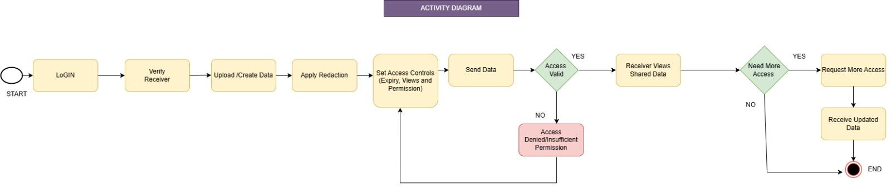

# Activity Diagram

**File:** `activity-diagram.png` (1600 x 339 px)

## Purpose
Shows the end-to-end workflow of sharing data securely in the CLOAKID system, from the sender logging in to the receiver viewing (or requesting more access to) the data.

## Flow (left to right)
1. **START**
2. **Login**
3. **Verify Receiver**
4. **Upload / Create Data**
5. **Apply Redaction**
6. **Set Access Controls** (Expiry, Views and Permission)
7. **Send Data**
8. **Decision: Access Valid?**
   - **YES** -> Receiver Views Shared Data
   - **NO** -> Access Denied / Insufficient Permission (red node) -> loops back to *Set Access Controls*
9. **Decision: Need More Access?**
   - **YES** -> Request More Access -> Receive Updated Data -> **END**
   - **NO** -> **END**

## Notes
- Yellow boxes = actions, green diamonds = decisions, red box = failure state.
- The denied-access loop lets the sender fix permissions and resend.
