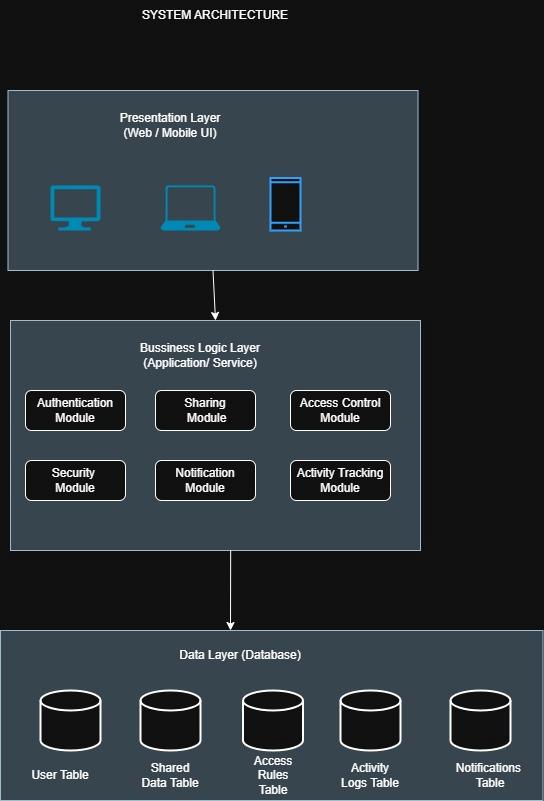

# System Architecture Diagram

**File:** `architecture-diagram.png` (544 x 801 px)

## Purpose
Shows the three-tier layered architecture of CLOAKID.

## Layers
### 1. Presentation Layer (Web / Mobile UI)
Desktop, laptop and mobile clients used by senders and receivers.

### 2. Business Logic Layer (Application / Service)
Six modules:
- Authentication Module
- Sharing Module
- Access Control Module
- Security Module
- Notification Module
- Activity Tracking Module

### 3. Data Layer (Database)
Five data stores:
- User Table
- Shared Data Table
- Access Rules Table
- Activity Logs Table
- Notifications Table

## Notes
Requests flow top-down: Presentation -> Business Logic -> Data (arrows in the diagram).
