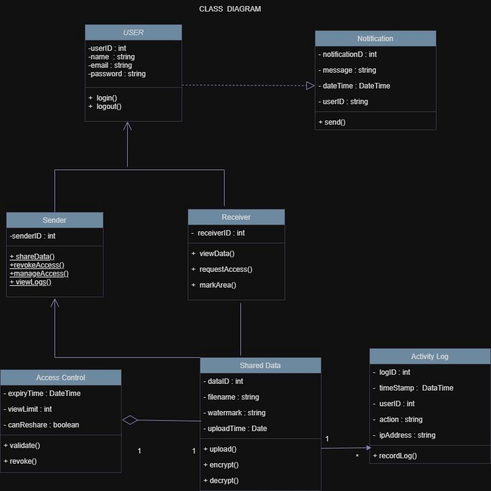

# Class Diagram

**File:** `class-diagram.png` (811 x 811 px)

## Purpose
Defines the main classes, attributes, operations and relationships of the system.

## Classes
| Class | Attributes | Methods |
|---|---|---|
| **User** | userID : int, name : string, email : string, password : string | login(), logout() |
| **Sender** (extends User) | senderID : int | shareData(), revokeAccess(), manageAccess(), viewLogs() |
| **Receiver** (extends User) | receiverID : int | viewData(), requestAccess(), markArea() |
| **Notification** | notificationID : int, message : string, dateTime : DateTime, userID : string | send() |
| **Shared Data** | dataID : int, filename : string, watermark : string, uploadTime : Date | upload(), encrypt(), decrypt() |
| **Access Control** | expiryTime : DateTime, viewLimit : int, canReshare : boolean | validate(), revoke() |
| **Activity Log** | logID : int, timeStamp : DateTime, userID : int, action : string, ipAddress : string | recordLog() |

## Relationships
- Sender and Receiver **inherit** from User.
- User **depends on / realizes** Notification (dashed arrow with hollow head).
- **Access Control** is **aggregated** with Shared Data (1 to 1, diamond).
- **Shared Data** to **Activity Log**: 1 to many (`1` -> `*`).
