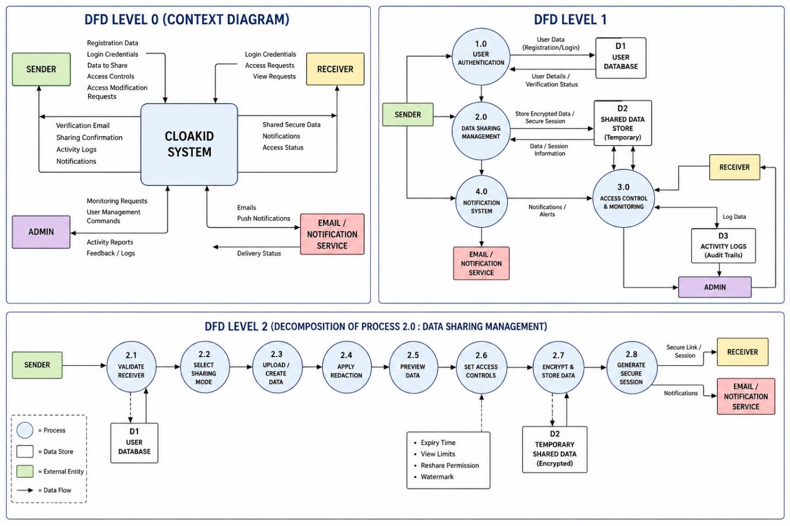

# Data Flow Diagrams (Level 0, 1, 2)

**File:** `dfd-level-0-1-2.png` (1438 x 959 px)

## Purpose
One image containing three DFD levels that decompose the CLOAKID system.

## Level 0 - Context Diagram
Single process **CLOAKID SYSTEM** with four external entities:
- **Sender**: sends registration data, login credentials, data to share, access controls, access modification requests; receives verification email, sharing confirmation, activity logs, notifications.
- **Receiver**: sends login credentials, access requests, view requests; receives shared secure data, notifications, access status.
- **Admin**: sends monitoring requests, user management commands; receives activity reports, feedback/logs.
- **Email / Notification Service**: receives emails and push notifications; returns delivery status.

## Level 1
Processes:
- **1.0 User Authentication** (uses D1 User Database)
- **2.0 Data Sharing Management** (uses D2 Shared Data Store - temporary)
- **3.0 Access Control & Monitoring** (writes to D3 Activity Logs / audit trails)
- **4.0 Notification System** (sends via Email / Notification Service)

External entities: Sender, Receiver, Admin, Email/Notification Service.

## Level 2 - Decomposition of Process 2.0 (Data Sharing Management)
Sequence of sub-processes:
1. **2.1** Validate Receiver (D1 User Database)
2. **2.2** Select Sharing Mode
3. **2.3** Upload / Create Data
4. **2.4** Apply Redaction
5. **2.5** Preview Data
6. **2.6** Set Access Controls (Expiry Time, View Limits, Reshare Permission, Watermark)
7. **2.7** Encrypt & Store Data (D2 Temporary Shared Data, encrypted)
8. **2.8** Generate Secure Session -> Secure link/session to Receiver, notifications to Email/Notification Service

## Legend
Blue circle = Process, white box = Data Store, green/yellow/purple/red = External Entities, arrow = Data Flow.
