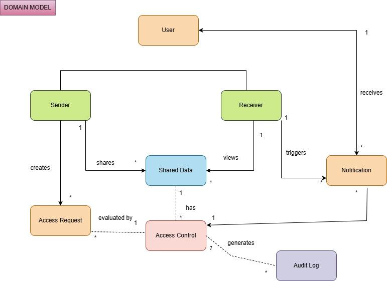

# Domain Model

**File:** `domain-model.png` (771 x 561 px)

## Purpose
Conceptual model of the main entities in the CLOAKID domain and how they relate.

## Entities
User, Sender, Receiver, Shared Data, Access Request, Access Control, Notification, Audit Log.

## Relationships (with multiplicity)
- **Sender** shares **Shared Data** (1 -> *).
- **Receiver** views **Shared Data** (1 -> *).
- **Sender** creates **Access Request** (* ).
- **Access Request** is evaluated by **Access Control** (* -> 1).
- **Shared Data** has **Access Control** (1 -> *).
- **Access Control** generates **Audit Log** (1 -> *).
- **Receiver** triggers **Notification** (1 -> *).
- **User** receives **Notification** (1 -> *).
- **Notification** is linked to **Access Control** (* -> 1).
- Sender and Receiver are specializations of User.
