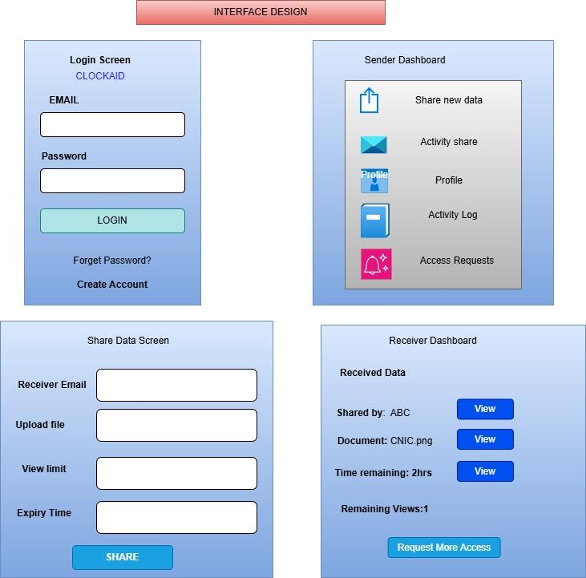

# Interface Design (UI Mockups)

**File:** `interface-design.png` (731 x 721 px)

## Purpose
Low-fidelity wireframes of the four main screens.

## Screens
### 1. Login Screen
Email field, Password field, **LOGIN** button, *Forget Password?* link, *Create Account* link. App name shown at top.

### 2. Sender Dashboard
Menu items: Share new data, Activity share, Profile, Activity Log, Access Requests.

### 3. Share Data Screen
Fields: Receiver Email, Upload file, View limit, Expiry Time; **SHARE** button.

### 4. Receiver Dashboard
"Received Data" list showing: Shared by (ABC), Document (CNIC.png), Time remaining (2 hrs), Remaining Views (1), each with a **View** button, plus a **Request More Access** button.

## Notes
The login mockup spells the app name as "CLOCKAID"; the project name elsewhere is CLOAKID. Consider correcting the mockup.
