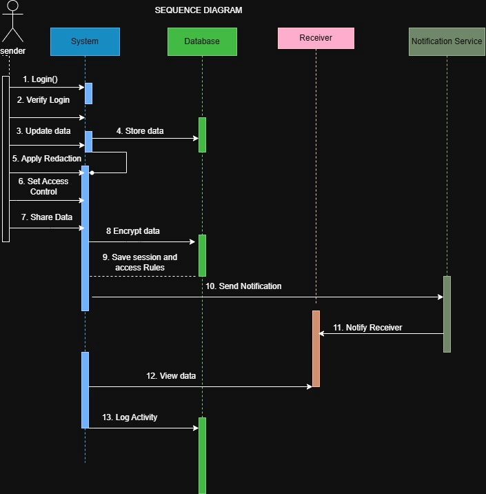

# Sequence Diagram

**File:** `sequence-diagram.png` (705 x 716 px)

## Purpose
Detailed message flow between internal components while a sender shares data.

## Participants
Sender (actor), System, Database, Receiver, Notification Service.

## Messages (in order)
1. Login()
2. Verify Login
3. Update data
4. Store data (System -> Database)
5. Apply Redaction (self-call)
6. Set Access Control
7. Share Data
8. Encrypt data (System -> Database)
9. Save session and access rules (Database -> System)
10. Send Notification (System -> Notification Service)
11. Notify Receiver (Notification Service -> Receiver)
12. View data (System -> Receiver)
13. Log Activity (System -> Database)
