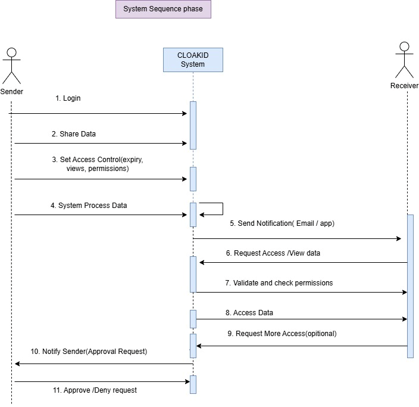

# System Sequence Diagram

**File:** `system-sequence-diagram.png` (704 x 683 px)

## Purpose
Black-box view: interactions between the actors and the CLOAKID System as a whole.

## Participants
Sender, CLOAKID System, Receiver.

## Messages (in order)
1. Login (Sender -> System)
2. Share Data
3. Set Access Control (expiry, views, permissions)
4. System Process Data (self-call)
5. Send Notification (Email / app) -> Receiver
6. Request Access / View data (Receiver -> System)
7. Validate and check permissions
8. Access Data (System -> Receiver)
9. Request More Access (optional, Receiver -> System)
10. Notify Sender (Approval Request)
11. Approve / Deny request (Sender -> System)
