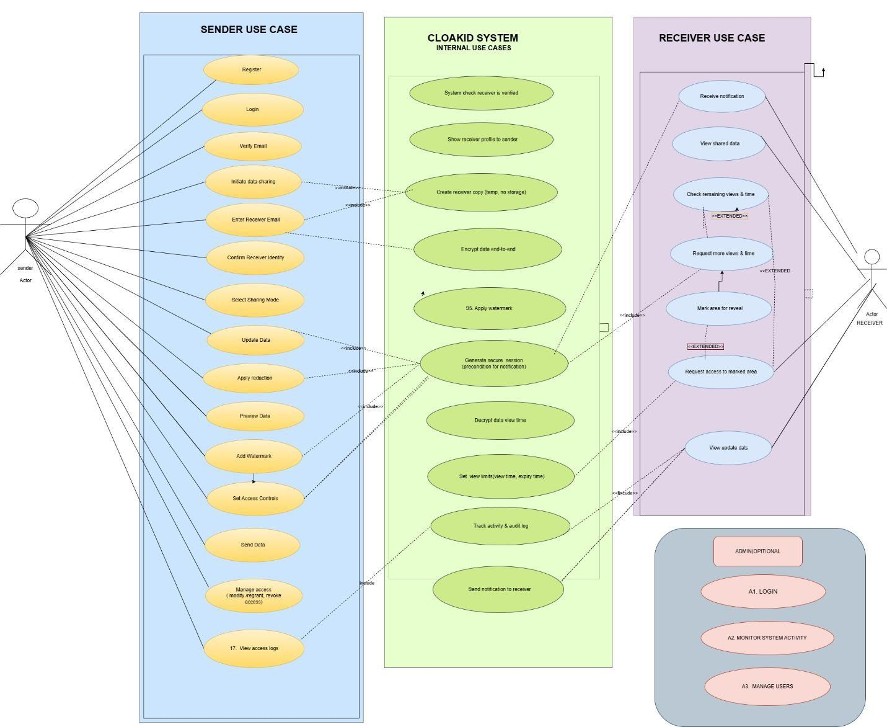

# Use Case Diagram

**File:** `use-case-diagram.png` (1431 x 1172 px)

## Purpose
Shows what each actor can do and which internal system use cases support them.

## Actors
Sender, Receiver, Admin (optional).

## Sender use cases
Register, Login, Verify Email, Initiate data sharing, Enter Receiver Email, Confirm Receiver Identity, Select Sharing Mode, Update Data, Apply redaction, Preview Data, Add Watermark, Set Access Controls, Send Data, Manage access (modify / regrant / revoke), View access logs.

## CLOAKID System (internal) use cases
System checks receiver is verified, Show receiver profile to sender, Create receiver copy (temp, no storage), Encrypt data end-to-end, Apply watermark, Generate secure session (precondition for notification), Decrypt data at view time, Set view limits (view time, expiry time), Track activity & audit log, Send notification to receiver.

## Receiver use cases
Receive notification, View shared data, Check remaining views & time, Request more views & time, Mark area for reveal, Request access to marked area, View updated data.

## Admin (optional)
A1 Login, A2 Monitor system activity, A3 Manage users.

## Relationships
Uses `<<include>>` (e.g. Initiate data sharing, Apply redaction, Add Watermark, Set Access Controls -> system use cases) and `<<extend>>` (e.g. Check remaining views, Mark area, Request access to marked area).
